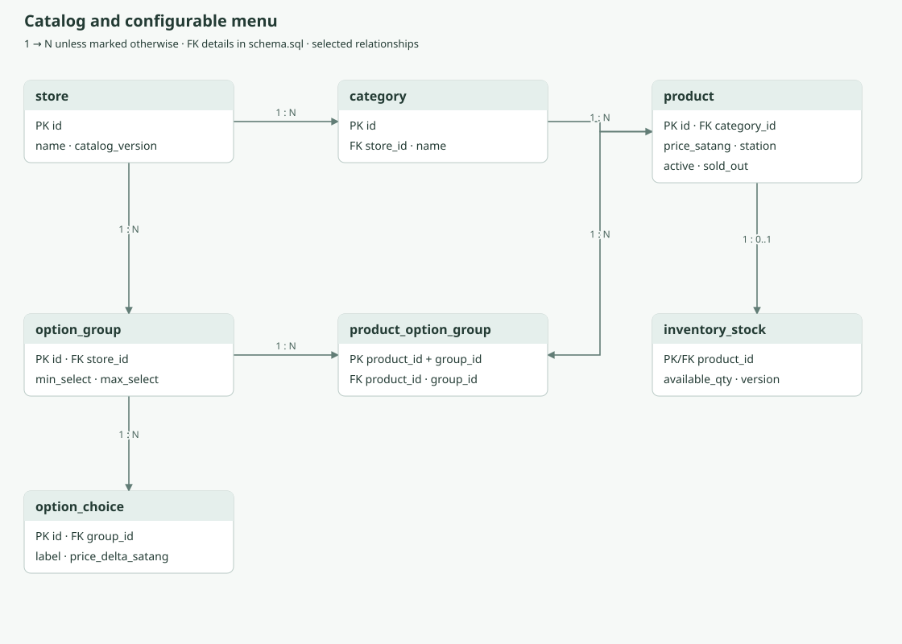
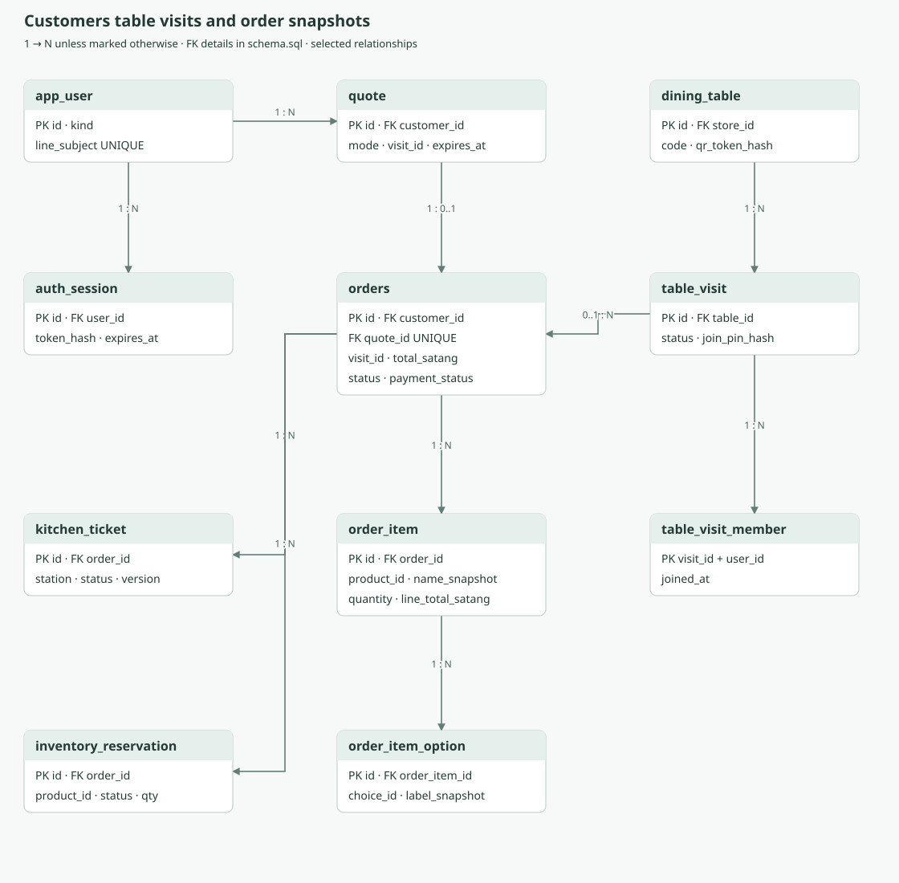
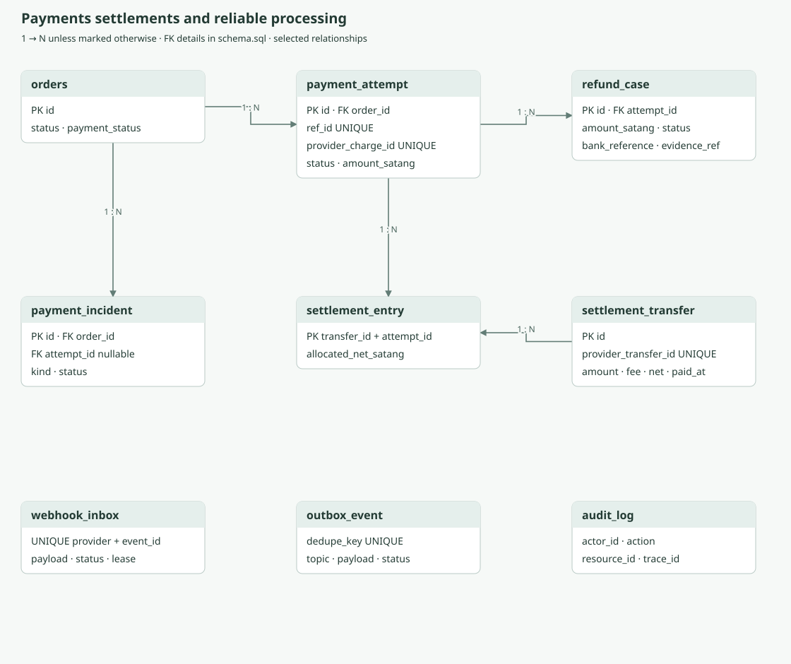
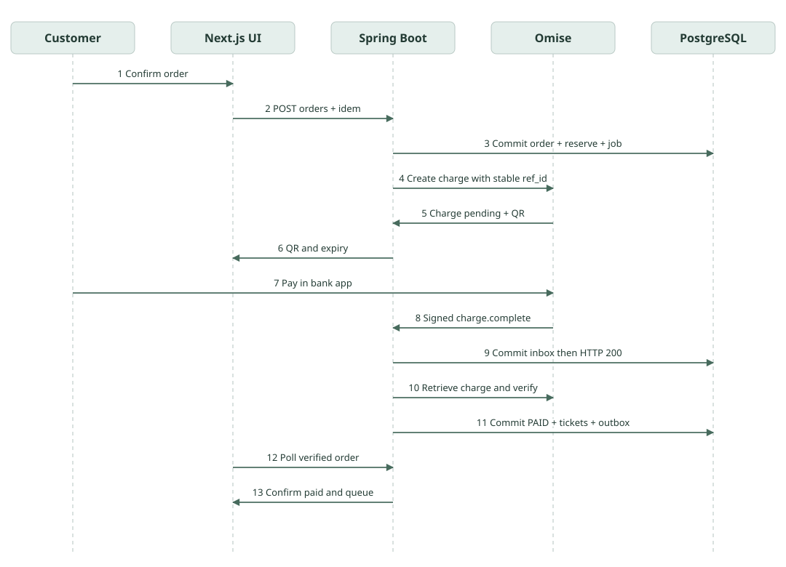

# เอกสารออกแบบระบบสั่งก๋วยจั๊บญวนและเครื่องดื่ม

เวอร์ชัน 1.0 • วันที่ 28 ตุลาคม 2569 • สำหรับเจ้าของร้านและทีมพัฒนา

เอกสารนี้กำหนดระบบร้านเดียวที่ลูกค้าสั่งผ่านเว็บหรือ LINE LIFF เลือกกินที่โต๊ะหรือรับกลับบ้าน และจ่ายด้วย Dynamic PromptPay ผ่าน Omise ระบบตรวจยืนยันการชำระบนเซิร์ฟเวอร์ก่อนส่งออเดอร์เข้าครัว ใช้ Next.js TypeScript, Spring Boot และ PostgreSQL โดยเริ่มจากแอปหลังบ้านชุดเดียวเพื่อลดค่าดูแล

**ข้อสรุปการออกแบบ:** แยกสถานะอาหารออกจากสถานะเงิน เก็บราคาขณะซื้อเป็นประวัติ ใช้ webhook ร่วมกับการเรียกตรวจสถานะจาก Gateway และมีงานกระทบยอดที่ทำงานเอง หาก LINE ส่งข้อความไม่สำเร็จ ลูกค้ายังดูสถานะจากหน้าออเดอร์ได้

ชุดส่งมอบประกอบด้วยเอกสารนี้, HTML สำหรับอ่านและพิมพ์, `schema.sql` สำหรับฐานข้อมูลตั้งต้น และ `openapi.json` สำหรับสัญญา API เวอร์ชัน 3.1 เอกสารเป็นข้อกำหนดสำหรับสร้างระบบ ยังไม่มีการเปิดร้านบนคลาวด์หรือทำธุรกรรมเงินจริง

## 1 ขอบเขตและสมมติฐาน

### 1.1 รุ่นแรกที่แนะนำ

| เรื่อง | ข้อกำหนด |
|---|---|
| ร้าน | 1 ร้าน 1 สกุลเงิน THB เวลาเปิดปิดตาม Asia/Bangkok |
| ภาระงานตั้งต้น | เป้าหมาย 100 ออเดอร์ต่อวัน 20 โต๊ะ ลูกค้าออนไลน์พร้อมกัน 50 คน ต้องทดสอบก่อนเปิดจริง |
| ลูกค้า | เข้าผ่าน LINE หรือ guest บนเบราว์เซอร์ พนักงานมีบัญชีแยก |
| กินที่โต๊ะ | สแกน QR โต๊ะ ใส่รหัสรอบโต๊ะที่พนักงานเปิดให้ แล้วสั่งจ่ายต่อออเดอร์ |
| กลับบ้าน | รับที่ร้านแบบเร็วที่สุด แจ้งช่วงเวลาโดยประมาณก่อนจ่าย ไม่รองรับจองเวลาล่วงหน้าในรุ่นแรก |
| การชำระ | จ่ายเต็มจำนวนก่อนทำอาหาร Dynamic PromptPay 1 ออเดอร์มีหลาย attempt ได้ แต่มีรายการที่กำลังจ่ายได้ครั้งละ 1 รายการ |
| สต็อก | จำนวนขายได้ต่อสินค้าและสวิตช์ของหมด ยังไม่ตัดวัตถุดิบตามสูตร |
| ครัว | หน้ารวมคิวและแยกสถานีอาหาร เครื่องดื่ม ปิดออเดอร์เมื่อทุกสถานีพร้อม |
| แจ้งเตือน | หน้าเว็บเป็นหลัก LINE push เมื่อรับเงินและพร้อมรับ ส่งเฉพาะผู้ที่ส่งหาได้และอยู่ในโควตา |
| รายงาน | ยอดขาย ยอดรับชำระ ค่าธรรมเนียม ยอดคืนเงิน และเงินโอนจาก Gateway แยกกัน |

ยังไม่รวมเดลิเวอรี หลายสาขา รวมบิลทั้งโต๊ะ แบ่งจ่าย เงินสด เครดิตร้าน คะแนนสมาชิก คูปอง เครื่องพิมพ์อัตโนมัติ และ e Tax Invoice การเพิ่มรายการหลังจ่ายให้สร้างออเดอร์ใหม่ ไม่แก้ออเดอร์ที่มี QR แล้ว

### 1.2 ค่าธุรกิจที่ใช้เริ่มพัฒนา

ค่าต่อไปนี้เป็นข้อเสนอที่ตั้งค่าได้ ไม่ใช่เงื่อนไขของผู้ให้บริการ: quote อายุ 2 นาที, QR จ่าย 10 นาที, จองจำนวนขายได้สูงสุด 12 นาทีเมื่อทราบผล Gateway, table session อายุ 90 นาที, guest session อายุ 24 ชั่วโมง, ลูกค้า LINE อายุ session 7 วัน, พนักงานหมดอายุเมื่อไม่ใช้ 30 นาทีและสูงสุด 12 ชั่วโมง

จำกัด 20 บรรทัดต่อออเดอร์ จำนวนต่อบรรทัด 1 ถึง 10 ยอดขายออนไลน์ขั้นต่ำ 20 บาทตามขั้นต่ำ PromptPay ที่ตรวจพบ และเพดานร้านกำหนด 5,000 บาทต่อออเดอร์ ในกรณี Gateway รองรับต่างจากนี้ ให้ใช้ขอบเขตที่เข้มกว่าระหว่างร้านและผู้ให้บริการ [S1]

## 2 การตัดสินใจหลักและสถาปัตยกรรม

| การตัดสินใจ | เหตุผลและผลต่อการพัฒนา |
|---|---|
| Modular monolith | Spring Boot ชุดเดียว มีโมดูล auth, catalog, ordering, payments, kitchen, notifications, reporting ลดภาระหลายบริการ |
| PostgreSQL เป็นข้อมูลหลัก | เก็บธุรกรรม ออเดอร์ งานเบื้องหลังและ session ในฐานข้อมูลเดียว เริ่มโดยไม่ใช้ Redis หรือ Kafka |
| Next.js แบบ static export | หน้าเว็บประมวลผลข้อมูลร้านผ่าน API ฝั่งลูกค้า ช่วยใช้ static hosting ราคาต่ำ |
| จ่ายก่อนทำ | ครัวเห็นเฉพาะรายการที่ยืนยันเงินแล้ว ลดออเดอร์ทิ้งและลดปัญหายอดค้าง |
| Gateway adapter | แยกโค้ด Omise ออกจากกฎออเดอร์ เพื่อเปลี่ยนผู้ให้บริการได้ภายหลัง |
| Durable inbox และ outbox | บันทึกเหตุการณ์ก่อนตอบรับ และส่งข้อความหลัง commit ป้องกันข้อมูลสำเร็จแต่แจ้งเตือนตกหล่น |
| Polling ในรุ่นแรก | ลูกค้าถามสถานะ 3 วินาทีเฉพาะหน้าจ่าย 10 วินาทีหน้าติดตาม ครัว 5 วินาที ลดงานดูแล WebSocket |

```text
ลูกค้า LINE LIFF / เว็บทั่วไป                 พนักงาน / ครัว / เจ้าของ
               │ HTTPS                                  │ HTTPS
               └──────── Next.js TypeScript Static UI ───┘
                              │ JSON HTTPS + session cookie + CSRF
                    Spring Boot REST API
                    ├─ Catalog / Quote / Orders
                    ├─ Table visits / Kitchen tickets
                    ├─ Payment adapter / Reconciliation
                    ├─ Auth / RBAC / Audit
                    └─ Inbox worker / Outbox worker / Scheduler
                              │ private network
                          PostgreSQL
                    ┌─────────┴─────────┐
             Omise API และ webhook    LINE Login / Messaging API
```

Next.js export ใช้ routes คงที่ `/menu/`, `/cart/`, `/checkout/`, `/pay/`, `/order/`, `/staff/`, `/kitchen/` รับ order ID ผ่าน query เช่น `/order/?id=UUID` ไม่ใช้ dynamic path ที่ต้องรู้ค่าตอน build, Server Actions, runtime Route Handlers, SSR หรือการตรวจ cookie ด้วย Next.js server ในชุด static นี้ ใช้ `output: 'export'`, `trailingSlash: true` และรูปภาพที่จัดขนาดแล้วหรือ image loader ภายนอก กฎความปลอดภัยทั้งหมดอยู่ที่ API [S7]

รุ่นที่เลือกพัฒนา: Java 25 LTS, Spring Boot สาย stable ที่ยังรองรับและ dependency เข้ากันได้ เช่น 4.1.x, PostgreSQL 17, Next.js สาย stable 16.x และ TypeScript strict โดยล็อก patch version ตอนเริ่มโครงการและทดสอบ CI เอกสาร Spring ปัจจุบันระบุ Boot 4.1.2 รองรับ Java 17 ขึ้นไป จึงใช้ Java 25 ได้ [S8]

## 3 ผู้ใช้และสิทธิ์

| บทบาท | สิ่งที่ทำได้ |
|---|---|
| Guest และ Customer | ดูเมนู สร้าง quote สั่งจ่าย ติดตามหรือขอยกเลิกออเดอร์ของตัวเอง |
| CASHIER | เปิดปิดรอบโต๊ะ ดูออเดอร์ร้าน ส่งมอบอาหาร ขอคืนเงิน แก้กรณีติดขัดตามสิทธิ์ |
| KITCHEN | ดูรายการอาหารและหมายเหตุที่จำเป็น เริ่มทำและกดพร้อมรายสถานี ไม่มีเบอร์โทรหรือรายงานเงิน |
| MANAGER | จัดเมนู ราคา จำนวนขายได้ เปิดปิดร้าน อนุมัติและยืนยันคืนเงิน ดูรายงาน |
| OWNER | สิทธิ์ manager และจัดการบัญชีพนักงาน กุญแจเชื่อมต่อและการตั้งค่าระบบ |

พนักงานใช้บัญชีเฉพาะบุคคลและ MFA แบบ TOTP ไม่ใช้ PIN โต๊ะเป็นรหัสพนักงาน API ตรวจทั้ง role, store scope และเจ้าของออเดอร์ทุกครั้ง UUID ที่เดายากไม่ทดแทน authorization

## 4 กฎเมนู ราคา และออเดอร์

สินค้าแบ่ง category เช่น ก๋วยจั๊บญวน และเครื่องดื่ม มีชื่อ รูป คำอธิบาย ราคา สถานีครัว และสถานะ active แต่ละสินค้าเชื่อม option group ที่ระบุจำนวนเลือกขั้นต่ำและสูงสุด เช่น ขนาด เลือก 1, ไข่ เลือก 0 ถึง 1, ความหวาน เลือก 1, น้ำแข็ง เลือก 1

option ต้องอยู่ในกลุ่มของสินค้านั้นและยัง active ห้ามส่ง ID ของไข่ไปใช้กับชา ค่าตัวเลือกเป็นเงินเพิ่มต่อหน่วยและเริ่มจากศูนย์ขึ้นไป ตัวเลือกซ้ำถูกปฏิเสธ จำนวนตัวเลือกต่อหนึ่งบรรทัดใช้กับทุกหน่วยในบรรทัด ถ้าความหวานต่างกันให้แยกบรรทัด

**สูตรราคา:** `line_total = quantity × (base_price + sum(option_price_delta))`; `total = subtotal + packaging_fee` รุ่นแรกไม่มีส่วนลดหรือ service charge ราคาแสดงต่อลูกค้าเป็นราคาสุทธิ สถานะจด VAT ของร้านและข้อความใบรับเงินต้องกำหนดก่อนเปิด หากร้านจด VAT ให้แตกภาษีที่รวมอยู่ในราคาตามการตั้งค่าร้าน ไม่บวก VAT ซ้ำ และให้ผู้ทำบัญชียืนยันรูปแบบเอกสาร

ตัวอย่าง TAKEAWAY: ก๋วยจั๊บ 60 บาท + ไข่ 10 บาท + ชา 25 บาท + ค่าห่อทั้งออเดอร์ 5 บาท = 100 บาท (`10000` สตางค์) หาก DINE_IN ไม่มีค่าห่อ ยอดเป็น 95 บาท ค่าธรรมเนียม Gateway เป็นค่าใช้จ่ายร้าน ไม่หักจากราคาสินค้าที่บันทึกขาย

เซิร์ฟเวอร์อ่านราคาจากฐานข้อมูล ไม่รับ `total`, `unitPrice`, `paid`, `role` จาก client quote เก็บ request และราคาที่คำนวณพร้อม `catalog_version`; ตอนสร้างออเดอร์ตรวจ quote ไม่หมดอายุ เวอร์ชันตรง และจำนวนขายได้ยังพอ หากเปลี่ยนราคาหรือสินค้าให้ตอบ `409 REQUOTE_REQUIRED` พร้อมให้ลูกค้าตรวจยอดใหม่ ไม่เปลี่ยนยอดเงียบ ๆ

สร้างออเดอร์และ snapshot ชื่อสินค้า ตัวเลือก ราคา สถานี และภาษีใน transaction เดียว สร้างแล้วห้ามแก้ยอดที่เกี่ยวกับ payment attempt เก่า ใบรับเงินแสดงหมายเลขร้าน วันที่ และรายละเอียดตามข้อมูล snapshot แม้เมนูเดิมถูกปิดขาย

## 5 สถานะและความถูกต้องของธุรกรรม

### 5.1 แยกสถานะสามชั้น

| ชั้น | ค่าและความหมาย |
|---|---|
| order.status | AWAITING_PAYMENT → QUEUED → PREPARING → READY → COMPLETED; ทางแยก CANCELLED, EXPIRED, ON_HOLD |
| payment_attempt.status | CREATING, UNKNOWN, PENDING, SUCCEEDED, FAILED, EXPIRED |
| order.payment_status | UNPAID, PENDING, PAID, PARTIALLY_REFUNDED, REFUNDED, REVIEW เป็นยอดสรุปจาก attempt และ refund ที่ยืนยันแล้ว |

`payment_attempt=SUCCEEDED` หมายถึง Gateway ยืนยันรับชำระ ไม่ได้หมายถึงโอนเข้าธนาคารแล้ว `order=COMPLETED` หมายถึงส่งมอบอาหารแล้ว ไม่ใช้แทนสถานะเงิน

| คำสั่ง | precondition | ผล |
|---|---|---|
| ยืนยันรับชำระ | charge ตรง ยอดตรง THB live mode ถูกต้อง และ order ยังจ่ายได้ | attempt SUCCEEDED, payment PAID, order QUEUED, reserve CONSUMED, สร้าง ticket และ outbox |
| เริ่มทำ | order QUEUED และ ticket สถานี QUEUED | ticket PREPARING, order PREPARING |
| พร้อม | ticket PREPARING | ticket READY; ทุก ticket READY จึง order READY |
| ส่งมอบ | order READY | order COMPLETED เก็บผู้ส่งมอบและเวลา |
| ลูกค้าขอยกเลิก | ยังไม่จ่ายและไม่มี attempt ที่ PENDING หรือ UNKNOWN | ตรวจ Gateway อีกครั้งก่อนปิดและคืนจำนวนขายได้ |
| จ่ายแล้วขอยกเลิก | ยังไม่เริ่มทำ หรือ manager อนุมัติข้อยกเว้น | ON_HOLD → CANCELLED พร้อมเปิด refund case เงินยัง PAID จนคืนจริง |
| หมดเวลาจ่าย | ถึง deadline และ Gateway ยืนยันไม่สำเร็จ/หมดอายุ | EXPIRED คืนจำนวนขายได้ครั้งเดียว |
| พบเงินหลังปิดออเดอร์ | order CANCELLED หรือ EXPIRED | attempt SUCCEEDED, payment REVIEW, order ON_HOLD เปิด incident ห้ามเข้าครัวเอง |

### 5.2 Idempotency และ concurrency

ทุก POST ที่สร้างออเดอร์ สร้าง attempt หรือคืนเงิน ต้องมี `Idempotency-Key` UUID และบันทึก `(principal_id, method, path, key)` พร้อม SHA256 ของ canonical request, สถานะประมวลผล และ response เดิม อายุเก็บ 7 วัน คีย์เดิม body เดิมคืน response เดิม คีย์เดิม body ต่างตอบ 409; กำลังประมวลผลตอบ 409 `REQUEST_IN_PROGRESS` และ `Retry-After: 2` client ใช้ key เดิมเมื่อ retry

คำสั่งเปลี่ยนสถานะใช้ `version` แบบ optimistic locking หาก version ไม่ตรงตอบ `409 STALE_VERSION` พร้อมอ่านข้อมูลใหม่ Payment worker lock แถว order ก่อน attempt และ reservation ตามลำดับเดียวกันเสมอ การจองสินค้าล็อก stock ตาม product UUID เรียงลำดับเพื่อหลีกเลี่ยง deadlock

ใช้ partial unique index ให้มี attempt ใน CREATING, UNKNOWN หรือ PENDING เพียงหนึ่งรายการต่อออเดอร์ ไม่สร้าง unique index ที่อนุญาต SUCCEEDED เพียงรายการเดียว เพราะต้องบันทึกความจริงหากผู้ใช้จ่ายซ้ำ เหตุการณ์ซ้ำไม่ทำให้เกิด ticket หรือ notification ซ้ำ โดยใช้ unique dedupe keys [S15]

`stock.available_qty` เป็นจำนวนที่ยังเปิดขายได้ ลดทันทีเมื่อ reserve; เมื่อจ่ายแล้วเปลี่ยน reserve เป็น CONSUMED โดยไม่ลดซ้ำ; เมื่อยกเลิกก่อนจ่ายเปลี่ยน RELEASED และคืนจำนวนแค่ครั้งเดียว สินค้าไม่จำกัดจำนวนใช้ `available_qty=NULL` แต่ยังตรวจ active และ sold_out การยกเลิกหลังเข้าครัวไม่คืน stock อัตโนมัติ ให้ manager ประเมินอาหารที่ใช้ไปแล้ว

## 6 Database ERD

ภาพรวมด้านล่างแบ่งข้อมูลลูกค้า เมนู และธุรกรรมเพื่อให้อ่านง่าย ฟิลด์จริงและ constraints อยู่ใน `schema.sql` ลูกศรในข้อความหมายถึง foreign key จากลูกไปแม่ ส่วนภาพ ERD ใช้ 1 ต่อ N ตามที่กำกับ และ `erd.mmd` เป็น Mermaid ERD เต็ม 29 ตาราง 43 foreign keys







```text
store ← dining_table ← table_visit ← table_visit_member → app_user
  ↑                         ↑                            ↑
category ← product          └──────── orders ────────────┘
              ↑                          │
product_option_group → option_group      ├─ order_item → order_item_option
                          ↑              ├─ inventory_reservation → inventory_stock
                    option_choice        ├─ kitchen_ticket
                                         ├─ order_status_event
                                         └─ payment_attempt ← refund_case
                                                ↑
                                         payment_incident

app_user ← auth_session
app_user ← staff_role
app_user ← idempotency_record
webhook_inbox → workers → orders / payment_attempt
orders → outbox_event → LINE Messaging API
settlement_transfer / settlement_entry → payment_attempt
audit_log → ผู้ปฏิบัติและ resource ที่เปลี่ยน
```

### 6.1 พจนานุกรมข้อมูล

| ตาราง | ฟิลด์หลักและหน้าที่ |
|---|---|
| store | UUID, name, timezone, currency, accepting_orders, hours JSON, packaging_fee_satang, catalog_version, tax settings |
| app_user | UUID, kind GUEST/CUSTOMER/STAFF, line_subject unique แบบ nullable, display_name, phone_ciphertext, password_hash, totp_secret_ciphertext, active |
| staff_role | user_id, store_id, role; PK รวม ป้องกัน role ซ้ำ |
| auth_session | token_hash unique, user_id, csrf_hash, expires_at, last_seen_at, absolute expiry |
| dining_table | store_id, code, qr_token_hash unique, active; QR token สุ่ม ไม่ใช้เลขโต๊ะอย่างเดียว |
| table_visit | table_id, join_pin_hash, status, expires_at, opened_by, closed_at; เปิดได้หนึ่ง visit ต่อโต๊ะ |
| table_visit_member | visit_id, user_id, joined_at; ยืนยันว่า user เข้ารอบโต๊ะนี้แล้ว |
| category | store_id, name, sort_order, active |
| product | category_id, name, price_satang, station, active, sold_out, image_url |
| option_group | store_id, name, min_select, max_select |
| option_choice | group_id, label, price_delta_satang, active |
| product_option_group | product_id, group_id; PK รวม |
| inventory_stock | product_id PK, available_qty nullable, version, updated_at |
| quote | customer_id, store_id, visit_id, mode, request JSON, calculated JSON, catalog_version, expires_at |
| orders | customer_id, store_id, visit_id nullable, quote_id unique, code unique, mode, status, payment_status, subtotal, packaging, total, tax snapshots, version, deadlines, pickup_name, phone_ciphertext และ pickup_code ที่เก็บทั้ง hash และ ciphertext เพื่อแสดงซ้ำให้เจ้าของ |
| order_item | order_id, product_id, name_snapshot, unit_base_satang, unit_options_satang, quantity, line_total_satang, station, note |
| order_item_option | order_item_id, choice_id, group/name/label snapshots, price_delta_satang |
| inventory_reservation | order_id, product_id, quantity, status, expires_at; unique order/product |
| kitchen_ticket | order_id, station, status, version, started_at, ready_at; unique order/station |
| order_status_event | order_id, from/to, actor_id nullable, reason, created_at |
| payment_attempt | order_id, provider, ref_id unique, provider_charge_id unique nullable, status, amount_satang, currency, expires_at, next_check_at, fee/net/provider_status/paid_at |
| webhook_inbox | provider, event_id, payload JSON, body_hash, received_at, status, attempt_count, next_attempt_at, locked_until; unique provider/event |
| outbox_event | topic, aggregate_id, dedupe_key unique, payload JSON, status, retry fields, expires_at |
| refund_case | attempt_id, amount, status REQUESTED/APPROVED/PAID/REJECTED, reason, bank details ciphertext, evidence reference, requested/approved/paid by |
| payment_incident | order_id, attempt_id nullable, kind, status, details, resolved_by/time |
| settlement_transfer | provider_transfer_id unique, amount, fee, net, status, bank_reference, paid_at |
| settlement_entry | transfer_id, attempt_id, allocated_net_satang; ใช้เมื่อรายงาน Gateway จับคู่ได้ |
| idempotency_record | principal_id, method, path, key, request_hash, state, response_code/body, expires_at |
| audit_log | actor_id, action, resource_type/id, redacted before/after JSON, trace_id, created_at |

### 6.2 ชนิดข้อมูลและ constraints

เงินทุกช่องใช้ `BIGINT` หน่วยสตางค์ บวกด้วย integer และตรวจ overflow ไม่ใช้ float จำนวนใช้ integer บวก เวลาใช้ `TIMESTAMPTZ` เก็บ UTC แสดง Asia/Bangkok ID ใช้ UUID ส่วน code หน้าร้านออกจาก sequence และมี unique constraint เช่น `Q001245` ไม่ใช้ code เป็นสิทธิ์เข้าถึง

`orders.total = subtotal + packaging`; `line_total = quantity × (unit_base + unit_options)`; currency THB; mode DINE_IN ต้องมี visit ส่วน TAKEAWAY ต้องไม่มี; refund amount > 0 และรวมที่ APPROVED/PAID ต้องไม่เกินยอดที่รับจริงของ attempt โดยตรวจใน transaction ที่ lock attempt; ลด refund approved ที่ถูกปฏิเสธกลับได้ตาม workflow

foreign keys ที่เกี่ยวกับประวัติใช้ RESTRICT ไม่ลบสินค้าที่มีประวัติ ให้ inactive แทน ตรวจ store เดียวกันของ category, option, visit, user role ใน service layer เพราะ FK แบบ UUID อย่างเดียวไม่บังคับเรื่องนี้

สร้าง index `(store_id,status,created_at)` บน orders, `(customer_id,created_at DESC)`, `(order_id)` บนรายการและ payment, `(status,next_attempt_at)` บน inbox/outbox และ `(status,next_check_at)` บน attempt เก็บ JSON สำหรับ snapshot และ payload เท่านั้น ฟิลด์ค้นหาสำคัญเป็น column

## 7 API Contract

### 7.1 กติกากลาง

Base URL `https://api.example.com/api/v1` ใช้ JSON UTF 8 และ ISO 8601 UTC เช่น `2026-10-28T04:00:00Z` จำนวนเงินลงท้าย `Satang` เพื่อระบุหน่วยชัด API ทั้งหมด version ใน path และสัญญาเต็มอยู่ใน `openapi.json` ตัวอย่าง domain เป็น placeholder ที่ต้องแทนด้วยโดเมนร้าน

Authentication ใช้ session cookie `__Host-session` ที่ API host, Secure, HttpOnly, SameSite=Lax, Path=/ และไม่มี Domain ตั้งค่า credentialed CORS เฉพาะ `https://shop.example.com` และ `https://staff.example.com`; frontend fetch ด้วย `credentials: 'include'` ทั้งสอง host อยู่ HTTPS และ site เดียวกัน ไม่ใช้โดเมนผู้ให้บริการคนละ site สำหรับ production

ก่อน login เรียก `GET /auth/csrf` เพื่อรับ anonymous session cookie และ CSRF token ใน JSON ทุกคำสั่งที่เปลี่ยนข้อมูลรวม login ส่ง `X-CSRF-Token` พร้อมตรวจ Origin ฝั่ง API ยกเว้น webhook ใช้การตรวจลายเซ็นของผู้ให้บริการแทน หลัง login rotate session และ CSRF token ส่ง token ใหม่ใน response ไม่เก็บ token ใน localStorage

ข้อผิดพลาดใช้ `application/problem+json` มี `type`, `title`, `status`, `code`, `detail`, `traceId`, `fieldErrors` โดยไม่ส่ง stack trace ตัวอย่าง `409 OUT_OF_STOCK`, `409 REQUOTE_REQUIRED`, `409 STALE_VERSION`, `409 REQUEST_IN_PROGRESS`, `422 INVALID_OPTION`, `410 QUOTE_EXPIRED`, `429 RATE_LIMITED`, `503 PAYMENT_PROVIDER_UNAVAILABLE` หน้า UI แสดงข้อความไทยจาก code

API รายการใช้ cursor opaque, limit 1 ถึง 100 ค่าเริ่มต้น 20 ไม่ใช้ offset สำหรับคิวที่เปลี่ยนบ่อย ทุกคำสั่งสร้าง resource คืน Location ตามที่เหมาะสม `X-Request-ID` ใช้ trace; ค่าที่ส่งจาก client ต้องตรวจรูปแบบและขนาดเสมอ

### 7.2 API ลูกค้าและสาธารณะ

| Method และ path | สิทธิ์ | Request และ Response สำคัญ |
|---|---|---|
| GET /auth/csrf | สาธารณะ | 200 `{csrfToken}` และ anonymous cookie |
| POST /auth/guest | anonymous + CSRF | `{}` → 201 session guest, userId, csrfToken |
| POST /auth/line | anonymous/guest + CSRF | `{idToken}` → 200 userId, csrfToken; verify กับ LINE ก่อนเชื่อมบัญชี |
| POST /auth/staff | anonymous + CSRF | `{username,password,totp}` → 200 userId, roles, csrfToken |
| POST /auth/logout | session + CSRF | `{}` → 204 ลบ session |
| GET /me | session | 200 user และ roles ที่จำเป็น |
| GET /store | สาธารณะ | 200 ชื่อร้าน เวลาเปิด acceptingOrders ค่าห่อและช่องทางติดต่อ |
| GET /menu | สาธารณะ | 200 catalogVersion, categories, products, groups, choices; ETag ได้ TTL 30 วินาที |
| POST /table-visits/join | customer/guest + CSRF | `{qrToken,pin}` → 200 Visit ที่มี id, tableCode, expiresAt |
| POST /quotes | customer/guest + CSRF | cart, mode, visitId → 201 quoteId, priced lines, totalSatang, expiresAt |
| POST /orders | customer/guest + CSRF + idem | `{quoteId,pickupName?,phone?}` → 201 Order |
| GET /orders | customer/guest | cursor → ออเดอร์ของตัวเองเท่านั้น |
| GET /orders/{id} | เจ้าของ | 200 Order รวมรายการ ยอด สถานะอาหารและเงิน โดยไม่รวมข้อมูลลับ Gateway |
| POST /orders/{id}/payment-attempts | เจ้าของ + CSRF + idem | `{method:'PROMPTPAY'}` → 201 PaymentAttempt หรือ 202 CREATING/UNKNOWN |
| GET /payment-attempts/{id} | เจ้าของ | 200 status, qrUrl, expiresAt, verifiedAt; UI polling |
| POST /orders/{id}/cancellation-requests | เจ้าของ + CSRF + idem | `{reason,version}` → 202 รอตรวจ/อนุมัติ ไม่รับประกันยกเลิกทันที |
| GET /orders/{id}/receipt | เจ้าของ | 200 JSON ใบรับเงินจาก snapshot; แสดงหลังยืนยันเงิน ไม่อ้างเป็นใบกำกับภาษีเต็มรูป |

### 7.3 API พนักงานและระบบภายนอก

| Method และ path | สิทธิ์ | การทำงาน |
|---|---|---|
| GET /staff/orders | CASHIER/MANAGER/OWNER | filter status/mode/date + cursor ดูคิวและปัญหาเงิน |
| GET /staff/orders/{id} | CASHIER ขึ้นไป | รายละเอียด order และ paymentAttempts สำหรับ recheck/refund ไม่คืน pickupCode |
| GET /staff/tables | CASHIER ขึ้นไป | โต๊ะทั้งหมดพร้อม visit ที่เปิดอยู่ ไม่มี PIN หรือ token |
| POST /staff/table-visits | CASHIER ขึ้นไป | `{tableId}` → 201 visit และ PIN แสดงครั้งเดียว |
| GET /staff/table-visits | CASHIER ขึ้นไป | รายการ visit ตาม status ไม่มี PIN |
| POST /staff/table-visits/{id}/close | CASHIER ขึ้นไป | `{version}` → 200 ปิดรับ order ใหม่ ไม่ปิดออเดอร์ที่จ่ายแล้ว |
| GET /staff/kitchen-tickets | KITCHEN ขึ้นไป | station/status + cursor รายการ ticket และ item station นั้น |
| POST /staff/kitchen-tickets/{id}/transition | KITCHEN ขึ้นไป | `{targetStatus,version}` → 200 ticket; state machine บังคับ |
| POST /staff/orders/{id}/complete | CASHIER ขึ้นไป | `{version,pickupCode?}` → 200 Order |
| POST /staff/orders/{id}/cancel | MANAGER/OWNER | `{version,reason}` → 200/202 ตามการตรวจเงินและครัว |
| POST /staff/payment-attempts/{id}/recheck | CASHIER ขึ้นไป | `{}` → 202 เพิ่มงานตรวจ ไม่รับค่า paid จากพนักงาน |
| POST /staff/refunds | CASHIER ขึ้นไป | `{attemptId,amountSatang,reason}` + idem → 201 refund case |
| GET /staff/refunds | CASHIER ขึ้นไป | รายการ refund ตามสถานะและ cursor |
| POST /staff/refunds/{id}/approve | MANAGER/OWNER | `{version}` → 200 case ที่อนุมัติ |
| POST /staff/refunds/{id}/reject | MANAGER/OWNER | `{version,reason}` → 200 case ที่ปฏิเสธก่อนโอน |
| PUT /staff/refunds/{id}/bank-details | MANAGER/OWNER | `{version,accountName,bankCode,accountNumber}` → 200 case เก็บปลายทางเข้ารหัส ไม่คืนข้อมูลบัญชีใน response |
| POST /staff/refunds/{id}/confirm-paid | MANAGER/OWNER | `{version,bankReference,evidenceRef}` + idem → 200 บันทึกเงินคืนที่โอนแล้ว |
| PUT /staff/products/{id} | MANAGER/OWNER | `{version,name,priceSatang,active,soldOut}` → 200 สินค้า catalogVersion ใหม่ |
| PUT /staff/products/{id}/stock | MANAGER/OWNER | `{version,availableQty}` → 200 stock; audit ทุกครั้ง |
| GET /staff/products/{id}/stock | MANAGER/OWNER | อ่านจำนวนขายได้และ version ก่อนแก้ |
| PUT /staff/store/availability | MANAGER/OWNER | `{acceptingOrders,reason}` → 200 เปิดปิดรับออเดอร์ |
| GET /staff/reports/daily | MANAGER/OWNER | `date=YYYY-MM-DD` ของไทย → 200 ยอดรับ ยอดขาย refund/fee/settlement แยก |
| GET /staff/payment-incidents | CASHIER ขึ้นไป | cursor → รายการเงินซ้ำ เงินช้า ยอดผิด และ provider timeout |
| POST /staff/payment-incidents/{id}/resolve | MANAGER/OWNER | `{version,resolution,note}` → 200; ห้ามแก้ประวัติรับเงินทิ้ง |
| POST /webhooks/omise | Omise signature | 200 หลัง inbox commit; 400 payload ผิด, 401 ลายเซ็นผิด, 503 ถ้าเก็บไม่ได้ |
| POST /webhooks/line | LINE signature | 200 หลัง inbox commit; รองรับ events ว่างจากการ Verify URL |
| GET /health/live | สาธารณะ | 200 ไม่มีข้อมูลภายใน |
| GET /health/ready | internal/monitor | 200 เมื่อ DB พร้อม 503 เมื่อยังรับธุรกรรมไม่ได้ |

การเพิ่มสินค้า หมวด กลุ่มตัวเลือก และบัญชีพนักงานใช้ seed/config ผ่าน release ในรุ่นแรก หน้าจัดการราคาหรือจำนวนขายได้รองรับเฉพาะข้อมูลที่ seed แล้ว หากต้องการเพิ่มเมนูเองทุกชนิดให้เพิ่ม CRUD contract ใน sprint ถัดไปอย่างชัดเจน

### 7.4 ตัวอย่างเส้นทางหลัก

```json
POST /api/v1/quotes
{
  "mode": "TAKEAWAY",
  "items": [
    {"productId":"11111111-1111-4111-8111-111111111111","quantity":1,
     "optionChoiceIds":["88888888-8888-4888-8888-888888888888","33333333-3333-4333-8333-333333333333"],"note":"ไม่ใส่ผักชี"},
    {"productId":"22222222-2222-4222-8222-222222222222","quantity":1,
     "optionChoiceIds":["44444444-4444-4444-8444-444444444444","99999999-9999-4999-8999-999999999999"]}
  ]
}

201
{
  "id":"55555555-5555-4555-8555-555555555555",
  "catalogVersion":12,"subtotalSatang":9500,"packagingFeeSatang":500,
  "totalSatang":10000,"currency":"THB","expiresAt":"2026-10-28T04:02:00Z",
  "lines":[{"name":"ก๋วยจั๊บญวน + ไข่","lineTotalSatang":7000},
           {"name":"ชาไทย หวานปกติ","lineTotalSatang":2500}]
}
```

```json
POST /api/v1/orders
Idempotency-Key: 7f1df535-c73f-4260-bf34-51312c80edaa
X-CSRF-Token: <session-bound-token>
{"quoteId":"55555555-5555-4555-8555-555555555555","pickupName":"คุณเอ"}

201
{"id":"66666666-6666-4666-8666-666666666666","code":"Q001245",
 "mode":"TAKEAWAY","status":"AWAITING_PAYMENT","paymentStatus":"UNPAID",
 "totalSatang":10000,"currency":"THB","version":0,
 "paymentDeadline":"2026-10-28T04:10:00Z","items":[]}
```

`items` ในตัวอย่าง response ถูกย่อเพื่ออ่านง่าย ส่วนระบบจริงคืนรายการ snapshot ตาม Order schema ตัวเลือกตัวอย่าง 8888 คือขนาดปกติ, 3333 คือเพิ่มไข่, 4444 คือหวานปกติ และ 9999 คือน้ำแข็งปกติ UUID เหล่านี้เป็นข้อมูลสมมติสำหรับสื่อสาร contract ไม่ใช่ seed ที่มีอยู่จริง

```json
POST /api/v1/orders/66666666-6666-4666-8666-666666666666/payment-attempts
Idempotency-Key: bfd34422-2587-4178-9d21-d8ae603cf4b2
{"method":"PROMPTPAY"}

201
{"id":"77777777-7777-4777-8777-777777777777","status":"PENDING",
 "amountSatang":10000,"currency":"THB",
 "qrUrl":"https://api.example.com/api/v1/payment-attempts/77777777-7777-4777-8777-777777777777/qr",
 "expiresAt":"2026-10-28T04:10:00Z","verifiedAt":null}
```

QR ใช้ authenticated binary endpoint `GET /payment-attempts/{id}/qr` ส่ง PNG ที่ API ตรวจสิทธิ์และแปลงจากไฟล์ Gateway ที่อนุญาตไว้ ไม่แสดง SVG หรือ download URL ที่ client ส่งมาเอง หาก retry สร้าง QR ใหม่หลังหมดอายุ ต้องสร้าง quote/order ใหม่ในรุ่นแรก เพื่อไม่ขยายเวลาจองสินค้าไม่จำกัด

## 8 Workflow การสั่งที่โต๊ะ

1. พนักงานเปิด table visit ให้โต๊ะ 05 ระบบสร้าง PIN 6 หลักสุ่มและเก็บ hash มีเพียงหนึ่ง visit ที่ OPEN ต่อโต๊ะ แสดง PIN ให้ลูกค้าที่โต๊ะ
2. ลูกค้าสแกน QR ซึ่งใช้ `https://liff.line.me/{LIFF_ID}/?tableToken=...` หรือเว็บทางเลือก รองรับการส่งพารามิเตอร์ผ่าน LIFF redirect และ liff.state ตาม SDK ให้ `liff.init()` และขั้นตอน login เสร็จก่อนค่อยลบ token ออกจาก URL ด้วย replaceState ไม่ส่งเข้า analytics และใช้ Referrer Policy แบบ no referrer
3. หน้าเว็บทำ guest/LINE session แล้วส่ง token และ PIN เข้า join endpoint API จำกัดจำนวนลอง ตรวจโต๊ะเปิดและ visit ยังไม่หมดอายุ ก่อนเพิ่ม membership
4. เลือกเมนูและตัวเลือก ระบบ quote แล้วสร้างออเดอร์พร้อม reserve ใน transaction ลูกค้าแต่ละคนเห็นเฉพาะออเดอร์ของตัวเอง แม้อยู่โต๊ะเดียวกัน
5. API สร้าง charge ลูกค้าจ่าย ระบบยืนยันเงินแล้วส่ง ticket อาหารและเครื่องดื่มเข้าครัว แสดงโต๊ะ 05 ใน ticket
6. แต่ละสถานีกดเริ่มและพร้อม เมื่อพร้อมครบจึงแจ้งพนักงานเสิร์ฟ CASHIER กดส่งมอบเป็น COMPLETED
7. พนักงานปิด visit เมื่อโต๊ะว่าง PIN เก่าใช้สร้าง order ใหม่ไม่ได้ ประวัติ order ที่มีอยู่ยังเข้าถึงได้ตามเจ้าของ

QR โต๊ะและ PIN ช่วยจำกัดการสั่งจากลิงก์ที่หลุด แต่ไม่พิสูจน์ตำแหน่งจริงแบบเด็ดขาด ออเดอร์ทุกครั้งยังต้องจ่ายก่อนเข้าครัว หากพบการใช้งานผิดปกติให้ rotate QR token และปิด visit เดิม

## 9 Workflow สั่งกลับบ้าน

1. เข้าจาก Rich Menu หรือเว็บ เลือก “รับกลับบ้าน” ดูเวลารอประมาณและสถานะร้านก่อนเลือกอาหาร
2. ใส่ชื่อรับอาหาร เบอร์โทรเป็นทางเลือกสำหรับติดต่อกรณีมีปัญหา หากใช้ guest และไม่กรอกเบอร์ ต้องแจ้งให้เก็บหน้าออเดอร์ไว้
3. แสดงค่าห่อและยอดสุดท้ายก่อนยืนยัน สร้าง order และ charge เช่นเดียวกับที่โต๊ะ
4. เมื่อยืนยันเงิน ส่งคิวครัวพร้อม code Q001245 สร้าง pickup code สุ่ม 6 หลักขณะสร้างออเดอร์ เก็บ hash สำหรับตรวจและ ciphertext สำหรับแสดงซ้ำแก่เจ้าของ ไม่ส่งรหัสนี้ให้ครัวหรือรายการพนักงานทั่วไป เก็บ email/โทรศัพท์/ข้อมูล LINE ออกจาก response ของครัว และจำกัดการลองรหัสรับตามออเดอร์
5. ครัวพร้อมครบแล้ว LINE แจ้ง “พร้อมรับ” ถ้าส่งหาได้ ลูกค้าดูสถานะหน้าเว็บได้เสมอ พนักงานตรวจ code และหลักฐานหน้าออเดอร์/รหัสรับก่อนส่งมอบ
6. หากไม่มารับตามเวลาร้านกำหนด พนักงานติดต่อและลงเหตุผลการจัดการ ไม่คืนเงินหรือกดยอดสูญเสียเองโดยไม่มีบันทึก

Guest กลับมาดูออเดอร์จาก session cookie เดิม ไม่ให้เปิดด้วย code อย่างเดียว หากล้าง cookie ให้ติดต่อร้านและตรวจข้อมูลซื้อด้วยพนักงาน การย้าย guest ไป LINE ต้องมี session guest เดิมและ ID token ที่ตรวจแล้วในคำขอเดียว ย้าย ownership ภายใน transaction และป้องกันการผูกซ้ำผิดบัญชี

## 10 Payment Gateway และ webhook

### 10.1 ผู้ให้บริการที่เลือก

เลือก **Omise ซึ่งใช้ในบริบท Opn Payments** สำหรับ Dynamic PromptPay ในประเทศไทย ราคาที่หน้าผู้ให้บริการระบุ 1.65% ต่อรายการก่อน VAT ค่าบริการ 7% และมีค่าธรรมเนียมโอนจากบัญชี Gateway เข้าธนาคารตามยอดโอน ต้องสมัคร ตรวจ KYC เปิด live account และเปิดวิธี PromptPay ก่อนใช้งานจริง [S2][S13]

เงื่อนไขที่มีผลต่อการออกแบบ: QR มีอายุและตั้ง `expires_at` ได้ไม่เกินขอบเขตผู้ให้บริการ, ยอดขั้นต่ำปัจจุบัน 20 บาท, ช่องทางนี้ไม่รองรับ void/refund ผ่าน Omise จึงใช้ refund case ที่พนักงานโอนคืนและบันทึกหลักฐาน กฎนี้ต้องตรวจซ้ำเมื่อเปลี่ยนผู้ให้บริการหรือเงื่อนไขบัญชี [S1]

QR นี้เป็นข้อมูลชำระเฉพาะ charge ที่ Gateway สร้าง ไม่ใช่ QR บัญชีพร้อมเพย์ส่วนตัวของร้าน ภาพสลิป ปุ่ม “จ่ายแล้ว” return URL และการนับถอยหลังหมด ไม่ใช่หลักฐานยืนยันรับเงิน

### 10.2 ขั้นตอนสร้าง charge โดยไม่จ่ายซ้ำ

1. Lock order ตรวจ owner, status, payment deadline, ยอดและ active attempt สร้าง attempt CREATING กับ `ref_id=attempt UUID` และบันทึกงาน CREATE_CHARGE ใน outbox แล้ว commit
2. Worker claim งานและ commit lease ก่อนเรียกภายนอก ตรวจว่า order ยังอยู่สถานะที่จ่ายได้และ deadline ยังไม่ผ่านทันทีที่เริ่มงาน หากยังไม่เคยเรียก Gateway และ deadline ผ่านแล้วให้จบโดยไม่สร้าง charge ห้ามถือ DB lock ระหว่างรอ API ส่ง Basic Auth ด้วย secret keyเฉพาะ backend, ใช้ currency `thb`, amount สตางค์จาก order, `source[type]=promptpay`, `expires_at=payment_deadline`, `ref_id` เดิม และ metadata เฉพาะ orderId/attemptId ไม่มีเบอร์หรือ LINE token
3. บันทึก provider charge ID, QR metadata ที่ผ่าน allowlist และ expiry ที่ Gateway ส่งกลับ กลับสถานะ PENDING ถ้า API ยังทำงานอยู่หน้าเว็บเห็น 202 แล้ว poll attempt
4. ถ้า timeout หรือผลไม่แน่ชัด ตั้ง UNKNOWN เก็บ attempt เดิม ห้ามสร้าง attempt ใหม่ ใช้ ref_id เดิมเพื่อป้องกัน charge ซ้ำ และค้น/กระทบยอดผ่าน API หรือ Dashboard จนรู้ผล `ref_id` เป็นความสามารถที่เอกสาร Charges API ปัจจุบันระบุ ต้องทำ sandbox contract test ว่าบัญชี/API version ที่ใช้ตอบ duplicate อย่างไร ถ้าค้นกลับไม่ได้ให้ manual review ไม่ออก charge ด้วย ref ใหม่ [S14]
5. การขอ charge ซ้ำด้วย ref เดิมอาจคืน duplicate error แทน response เดิม ต้องจัดการโดยอ่าน charge เดิม ไม่ตีความ duplicate เป็น payment failure

### 10.3 รับ webhook อย่างปลอดภัย

Omise ปัจจุบันมี `Omise-Signature` และ `Omise-Signature-Timestamp` เมื่อกำหนด webhook secret ตรวจ HMAC SHA256 จาก `timestamp + '.' + raw body` ด้วย secret ที่ Base64 decode แล้ว ผลลัพธ์ hex เปรียบเทียบแบบ constant time รับ signature หลายค่าช่วง rotate secret และตั้ง timestamp tolerance 5 นาทีเป็นนโยบายระบบ ต้อง sync เวลาเซิร์ฟเวอร์ [S3]

1. อ่าน raw bytes ก่อน JSON parsing จำกัด body 256 KB ตรวจ signature และ timestamp ก่อนบันทึก event
2. parse event ID และ key รองรับอย่างน้อย `charge.complete`, `charge.create`, `charge.update`, `transfer.pay` และ `transfer.send`; unknown type ที่ลายเซ็นถูกต้องบันทึกเป็น IGNORED
3. insert inbox แบบ unique `(provider,event_id)` แล้ว commit ก่อนตอบ 200 หากซ้ำตอบ 200 โดยไม่เกิดผลซ้ำ ถ้า DB ใช้ไม่ได้ตอบ 503; ไม่ตอบสำเร็จก่อนบันทึก
4. Worker claim inbox ด้วย lease เรียก `GET /charges/{id}` โดยใช้ secret key ที่ตั้งไว้ fixed host ไม่เรียก URL จาก payload ตรวจ charge ID ที่รู้จัก หรือ `ref_id` ที่ผูกกับ attempt ภายใน, metadata ประกอบ, amount, currency, live mode และ status
5. ลายเซ็น webhook เพียงอย่างเดียวไม่แทนการตรวจยอด ใช้ข้อมูลที่อ่านจาก Gateway เป็นหลักฐานการเงิน หาก mapping หรือยอดไม่ตรง เปิด incident และคงสถานะ REVIEW ไม่เข้าครัว
6. ใน transaction lock order ก่อน attempt ถ้าสำเร็จครั้งแรก อัปเดต attempt/order/reserve สร้าง kitchen tickets, status history, และ LINE outbox พร้อมกัน ถ้าซ้ำหรือ event เก่าตามหลัง ไม่ลดสถานะ SUCCEEDED กลับเป็น PENDING/FAILED

Omise ระบุว่าไม่ได้รับประกันการ retry webhook ที่ส่งล้มเหลว จึงต้องมี reconciliation ของเราเอง [S3] LINE webhook ใช้กลไกคนละชุดตามหัวข้อ 12 ห้ามใช้ secret สลับกัน



### 10.4 การกระทบยอดและกรณีขอบ

| สถานการณ์ | พฤติกรรมที่ต้องพัฒนา |
|---|---|
| ผู้ใช้กลับจากแอปธนาคาร | เรียก GET attempt ตรวจสถานะจาก backend ไม่รับ paid=true จาก URL |
| webhook ไม่มา | งานทุก 60 วินาทีตรวจ attempt ที่ถึง next_check_at แบบ batch/backoff และ API rate limit |
| QR หน้าจอหมดเวลา | แสดง “กำลังตรวจผล” backend ตรวจอีกครั้งก่อน expire และปล่อย stock ไม่ใช้เวลาจากมือถือ |
| API/เน็ตขัดข้องตอนหมดเวลา | คง UNKNOWN หรือ ON_HOLD และแจ้งพนักงาน ไม่ยืนยันล้มเหลวหรือออก QR ใหม่; ถ้าต้องคืน stockเพื่อเปิดขาย ให้ปิด order เป็น ON_HOLD และจ่ายทีหลังเข้ากรณี late paid |
| เงินช้าหลังคืน stock | บันทึกรับเงินจริง เปิด LATE_PAYMENT manager เลือกสั่งใหม่และ reserve ใหม่หากยังทำได้ หรือคืนเงิน ห้ามให้ worker เข้าคิวครัวเอง |
| จ่ายซ้ำหลาย charge | เก็บทุก SUCCEEDED คำนวณรับเกินและเปิด DUPLICATE_PAYMENT ไม่สร้างอาหารซ้ำ |
| Gateway ล่มก่อนสร้าง QR | หยุดจ่าย แสดงลองใหม่ด้วย idem/ref เดิม หากทราบแน่ชัดว่ายังไม่มี charge จึงจบ attempt failed ได้ |
| ใช้ test event กับ live | ปฏิเสธผลทางธุรกิจและแจ้งเตือน เก็บ trace โดยไม่เปลี่ยนยอดเงินจริง |
| ลูกค้ายกเลิกแต่ charge ยัง pending | บันทึกคำขอ หยุดสร้าง QR ใหม่ รอตรวจจนหมดอายุ เพราะซ่อน QR ไม่ใช่ยกเลิกที่ Gateway |
| ร้านปิดหลังลูกค้าจ่าย | ออเดอร์ที่ยืนยันแล้วทำต่อ หรือ manager ยกเลิกพร้อม refund case ไม่ทำให้เงินหายจากรายงาน |

งานกู้คืนตอน restart ต้องค้น PENDING/UNKNOWN/CREATING และงาน lease หมดอายุทันที ทุกคืนตรวจ charge ย้อนหลังอย่างน้อย 48 ชั่วโมงรวม terminal ที่เพิ่งเปลี่ยนสถานะ และรายงานรายวันเทียบ order กับรายการ Gateway ที่อ่านได้แบบแบ่งหน้า ติดตาม UNKNOWN ต่อจนรู้ผลหรือมีการปิด incident โดยผู้รับผิดชอบ

### 10.5 เงินโอนเข้าบัญชีและคืนเงิน

ตาราง settlement แยกยอด charge สำเร็จ ยอดหักค่าธรรมเนียม และ transfer ที่ Gateway ส่งธนาคาร ใช้ webhook transfer ร่วมกับ GET transfer และรายงานกระทบยอด; เวลาเงินใช้ได้และตารางโอนขึ้นกับบัญชีผู้ให้บริการ ไม่รับประกันว่าเข้าธนาคารทันทีหลังลูกค้าสแกน [S12]

PromptPay refund: CASHIER เปิด case → MANAGER ตรวจยอดที่คืนได้และอนุมัติ → ผู้มีสิทธิ์โอนคืนผ่านธนาคาร → บันทึก bankReference/evidenceRef → จึงตั้ง PAID และอัปเดต payment aggregate อย่าสร้างปุ่มเรียก refund API ที่ช่องทางนี้ทำไม่ได้ [S1] แยกผู้ขอและผู้อนุมัติเมื่อมีทีมมากกว่าหนึ่งคน เจ้าของร้านคนเดียวใช้ OWNER override พร้อม audit และเหตุผล

หลักฐานรับเงินคืนเก็บใน private object storage หรือระบบเอกสารบัญชีที่จำกัดสิทธิ์ ไม่เปิด URL สาธารณะ รวมยอด APPROVED และ PAID ภายใต้ lock เพื่อกันสองคนอนุมัติคืนเกินยอด กรณีส่งธนาคารแล้ว timeout ต้องตรวจ bank reference ก่อนทำซ้ำ การคืนเงินจากธนาคารอาจไม่ได้ทำให้ยอด balance ที่ Omise ลด จึงลงเป็นรายการเงินออกภายนอกแยกไว้

## 11 UI Wireframe และพฤติกรรมหน้าจอ

หน้ามือถือออกแบบที่กว้างอย่างน้อย 360 px ตัวอักษรไทยอ่านง่าย ปุ่มสัมผัสอย่างน้อย 44 px สถานะใช้ทั้งข้อความและสี แจ้งราคา ตัวเลือกบังคับ ค่าห่อ และเวลารอให้เห็นก่อนจ่าย

### 11.1 เมนูและตัวเลือก

```text
┌──────────────────────────────────┐
│ ก๋วยจั๊บญวนบ้านเรา      เปิดรับสั่ง │
│ [ กินที่โต๊ะ 05 ] [ รับกลับบ้าน ]  │
│ [ก๋วยจั๊บ] [เครื่องดื่ม]           │
│ ก๋วยจั๊บญวน              60 บาท  │
│ หมูยอ หมูสับ น้ำซุปร้อน      [ + ]│
│ ชาไทย                   25 บาท  │
│ เลือกความหวานและน้ำแข็ง       [ + ]│
│                                  │
│ [ ตะกร้า 2 รายการ       95 บาท ] │
└──────────────────────────────────┘
┌──────────── เลือกตัวเลือก ─────────┐
│ ก๋วยจั๊บญวน                       │
│ ขนาด *      (●)ปกติ ( )พิเศษ +15 │
│ เพิ่มไข่     [✓] ไข่ +10          │
│ หมายเหตุ     [ไม่ใส่ผักชี      ]  │
│ จำนวน           [−] 1 [+]       │
│ [ เพิ่มลงตะกร้า          70 บาท ] │
└──────────────────────────────────┘
```

สินค้าของหมดปิดปุ่มเพิ่ม ตะกร้ายังคงข้อมูลบนอุปกรณ์ได้โดยไม่มีข้อมูลชำระหรือส่วนบุคคล หากเปลี่ยน mode ต้อง quote ใหม่ PIN ผิดไม่บอกว่าโต๊ะมีใครนั่ง

### 11.2 ตรวจรายการและจ่าย

```text
┌────────── ตรวจรายการกลับบ้าน ──────┐
│ ก๋วยจั๊บ + ไข่ ×1            70  │
│ ชาไทย ×1                    25  │
│ ค่าบรรจุภัณฑ์                 5  │
│ รวมสุทธิ                  100 บาท│
│ ชื่อรับอาหาร [คุณเอ            ] │
│ โทรศัพท์     [ไม่บังคับ          ] │
│ เวลารอประมาณ 10 ถึง 15 นาที       │
│ [ สร้างออเดอร์และไปชำระเงิน ]      │
└──────────────────────────────────┘
┌────────── ชำระ Q001245 ──────────┐
│ ยอดชำระ                   100 บาท│
│           [ Dynamic QR ]         │
│ ใช้แอปธนาคารสแกนหรือเลือกรูป QR    │
│ [บันทึก QR]    หมดอายุ 04:32      │
│ สถานะ กำลังรอการชำระ             │
│ ระบบตรวจอัตโนมัติ ไม่ต้องส่งสลิป    │
│ [ดูวิธีจ่ายบนมือถือเครื่องเดียว]   │
└──────────────────────────────────┘
```

มือถือเครื่องเดียวใช้บันทึกรูป QR หรือ screenshot แล้วเลือกภาพในแอปธนาคารที่รองรับ และกลับมาหน้าเดิม หาก LIFF บันทึกภาพไม่ได้ให้แนะนำ screenshot หรือเปิดเบราว์เซอร์ภายนอก ทดสอบบน iOS/Android จริงแต่ละธนาคาร ไม่สมมติว่ามี deep link เข้าแอปธนาคารได้ทุกแห่ง [S1]

ปุ่มสร้างออเดอร์ disable ระหว่างส่ง ใช้ key เดิมหลัง timeout เมื่อกลับมา foreground ให้ revalidate สถานะทันที เมื่อหมดเวลาแสดงกำลังตรวจผล หากยังไม่รู้ผลให้แสดงข้อความติดต่อร้านพร้อม code ไม่เสนอให้จ่ายซ้ำ

### 11.3 ติดตามออเดอร์และคิวครัว

```text
┌──────────── Q001245 ──────────────┐
│ รับกลับบ้าน     รหัสรับ 482915      │
│ ชำระแล้ว 100 บาท                 │
│ ✓ รับเงิน → ● กำลังทำ → พร้อมรับ  │
│ ก๋วยจั๊บ   กำลังทำ                │
│ ชาไทย     พร้อมแล้ว               │
│ ระบบแจ้งเมื่อพร้อมครบทุกอย่าง       │
│ [ใบรับเงิน]      [ติดต่อร้าน]      │
└──────────────────────────────────┘

หน้าครัวแท็บเล็ต
┌──────────────┬──────────────┬─────────────┐
│ รอทำ         │ กำลังทำ       │ พร้อม        │
├──────────────┼──────────────┼─────────────┤
│ โต๊ะ05 Q1244 │ กลับบ้าน Q1245│ โต๊ะ02 Q1241 │
│ 2 ก๋วยจั๊บ    │ 1 ก๋วยจั๊บ+ไข่  │ รอพนักงานเสิร์ฟ│
│ ไม่ผักชี      │ 4 นาที         │              │
│ [เริ่มทำ]     │ [พร้อม]        │              │
└──────────────┴──────────────┴─────────────┘
```

หน้าครัวมี filter station และเวลาออเดอร์ หากเน็ตหลุดให้ขึ้นแถบ “ข้อมูลอาจไม่ล่าสุด” แสดง last synced time และหยุดส่งคำสั่งเมื่อ offline ไม่ทำ offline payment หรือแสดงสำเร็จล่วงหน้า การกดซ้ำต้องตอบจาก state/version เดิมอย่างปลอดภัย เสียงแจ้งคิวต้องได้รับ user interaction เพื่อเปิดเสียงตามข้อจำกัดเบราว์เซอร์

### 11.4 หลังร้าน

```text
วันนี้ 28 ต.ค. 2569       [เปิดรับออเดอร์ ✓]
รับชำระ 10,000 | คืน 200 | Gateway fee แยก | เงินโอนธนาคารแยก
[ออเดอร์] [โต๊ะ] [ของหมด] [ปัญหาชำระเงิน] [รายงาน]

ออเดอร์    แบบ       อาหาร        เงิน          คำสั่ง
Q001245    กลับบ้าน   พร้อม        จ่ายแล้ว      [ส่งมอบ]
Q001246    โต๊ะ05     รอตรวจเงิน    กำลังตรวจ     [ตรวจอีกครั้ง]
Q001247    กลับบ้าน   พักรายการ    เงินเข้าช้า    [เปิดกรณี]
```

หน้า incident แสดงยอดและประวัติที่ต้องตรวจพร้อม “รับทำหลังตรวจสต็อก” หรือ “เปิดคืนเงิน” ไม่ใส่ปุ่มแก้เป็น PAID ด้วยมือ ต้องมีเหตุผลและ audit เมื่อแก้กรณีพิเศษ

## 12 การเชื่อม LINE OA และ LIFF

1. ร้านเป็นเจ้าของ LINE OA, provider และ LINE Login channel เปิด Messaging API จาก OA แล้วสร้าง LINE Login channel สำหรับ LIFF ภายใต้ provider เดียวกัน เพื่อให้ user ID ใช้อ้างอิงกันได้ ตรวจสิทธิ์และนโยบายข้อมูลของบริการก่อนเชื่อมข้อมูล [S5]
2. ลงทะเบียน LIFF endpoint เป็น `https://shop.example.com/` ขนาด Full ใช้ scopes `openid profile` โดยไม่ขอ email ถ้าไม่จำเป็น เชื่อม OA กับ Login channel และตั้ง rich menu “สั่งอาหาร”, “ออเดอร์ของฉัน”, “ติดต่อร้าน”
3. เรียก `liff.init({liffId})` ฝั่ง client หลังโหลดเว็บ ถ้าเบราว์เซอร์ภายนอกให้เลือก guest หรือ LINE Login ได้อย่างชัดเจน การเปิด LIFF ใน LINE ไม่ควรทำให้ guest flow บนเว็บทั่วไปเสีย
4. ส่ง `liff.getIDToken()` ให้ backend ตรวจผ่าน LINE verify endpoint พร้อม expected client_id ตรวจ token validity, audience, issuer, exp และ nonce เมื่อ login flow ใช้ nonce ห้ามเชื่อ userId/displayName ที่ client ส่งจาก getProfile หรือ decoded token [S4]
5. เก็บ LINE subject และชื่อที่จำเป็นหลังตรวจ token แล้ว ไม่เก็บ ID token/access token ใน log หรือฐานข้อมูลเป็นประวัติ ใช้ session ของร้านสำหรับ API หลัง login
6. ข้อความ “จ่ายสำเร็จ” และ “พร้อมรับ” ส่งจาก backend Messaging API ผ่าน outbox ใช้ channel access token เก็บ secret manager ใช้ retry key เดิมเมื่อ endpoint รองรับเพื่อกันข้อความซ้ำ แยก dedupe key ตาม order และ milestone
7. LINE webhook ตรวจ `x-line-signature` เทียบ Base64 HMAC SHA256 ของ raw request body โดยใช้ Messaging channel secret เก็บแต่ละ event ด้วย `webhookEventId` เพื่อ dedupe รับ follow/unfollow และเปลี่ยนความสามารถแจ้งเตือน; webhook Verify ที่ events=[] ต้องตอบได้ [S6]
8. ผู้ใช้ต้องอยู่ในเงื่อนไขที่ LINE อนุญาตให้ส่ง push เช่นเป็นเพื่อน OA ไม่ถือว่า LINE Login เท่ากับเพิ่มเพื่อน หาก block หรือโควตาเต็มบันทึกส่งไม่ได้ หน้าออเดอร์ยังใช้ได้

ไม่ใช้ `liff.sendMessages()` เป็นช่องทางยืนยันธุรกรรมหรือส่งข้อความลับใน group chat และไม่ใช้ LINE Notify ในระบบนี้ ส่งลิงก์ออเดอร์ที่ยังต้อง login/มี session ไม่ส่ง QR ชำระ รหัสรับอาหาร หรือโทรศัพท์ให้ผิดคน

ตามแพ็กเกจไทยที่ตรวจพบ Free 300 ข้อความต่อเดือน, Basic 1,280 บาท 15,000 ข้อความ, Pro 1,780 บาท 35,000 ข้อความก่อนเงื่อนไขภาษี/ค่าใช้เกินของแพ็กเกจ; push นับโควตา ส่วน reply ใช้หลักนับต่างกัน ต้องตรวจ dashboard และเงื่อนไขปัจจุบัน ห้ามเก็บ reply token ไว้ส่งแจ้งสถานะอีกหลายสิบนาทีภายหลัง [S9][S10]

## 13 Security และข้อมูลส่วนบุคคล

### 13.1 มาตรการที่ต้องมีในรุ่นแรก

| ความเสี่ยง | มาตรการและเกณฑ์ตรวจ |
|---|---|
| ปลอมตัวลูกค้า | verify LINE token ที่ backend, rotate session, guest session entropy ≥256 bits เก็บ hash ของ token |
| อ่าน order คนอื่น | ทุก resource query จำกัด customer_id/store scope; ส่ง 404 เมื่อไม่มีสิทธิ์ ลดการยืนยันว่ามี resource นั้น |
| CSRF และ CORS | exact origin allowlist, CSRF ต่อ session รวม login, credentials true, ไม่ใช้ wildcard |
| XSS | escape ชื่อ/หมายเหตุ ไม่ render HTML จากร้าน/ลูกค้า CSP จำกัด script/connect/image รวมเฉพาะ LINE SDK และ API ที่ใช้ |
| SQL injection | prepared queries/JPA parameterization, validation ไม่ต่อ SQL จาก filter |
| เปลี่ยนราคาเอง | backend คิดยอด ตรวจ quote version และ snapshot; client ไม่มีสิทธิ์ส่งสถานะเงิน |
| webhook ปลอม/replay | ตรวจ raw-body signature, timestamp เมื่อ provider มี, event dedupe และ retrieve resource ด้วย fixed API host |
| secret รั่ว | Gateway secret, LINE token/secret, DB password และ TOTP encryption key อยู่ server secret manager ไม่ใช้ NEXT_PUBLIC และไม่ฝังใน image |
| SSRF ผ่าน QR | ดึง QR เฉพาะ host/path provider ที่กำหนด ไม่ตาม redirect ไปเครือข่าย private จำกัดขนาด/timeouts ตรวจ media และแปลงเป็น PNG |
| บัญชีพนักงาน | Argon2id password hash, TOTP, login rate limit, สิทธิ์รายคน, disable session ทันทีเมื่อเลิกงาน/พ้นสภาพ |
| การสั่งรบกวน | rate limit ตาม IP+session+resource, จำกัด pending order, PIN attempts 5 ครั้งต่อ 5 นาทีและ backoff ไม่มี lockout ทั้งร้านจาก IP เดียว |
| ข้อมูลใน log | redact cookie, Authorization, tokens, raw phone, bank data, QR link ใช้ traceId/orderId แทน |
| ขโมย backup | เข้ารหัส backup จำกัดสิทธิ์ แยกที่เก็บจาก DB และลองกู้คืนจริง |
| การแก้ยอด/คืนเงิน | audit ทุก transition, แยกผู้อนุมัติ, lock ยอด, ไม่มีการลบ payment history ผ่าน UI |

ค่า rate limit ตั้งต้น: public menu 120 ครั้งต่อนาทีต่อ IP, quote 30 ต่อ session, create order 10, create payment 5, login 5 ต่อนาทีต่อ identity และ IP; webhook มี quota แยกไม่ปะปนลูกค้า ปรับด้วย load test และคำนึงถึง Wi Fi ร้านที่แชร์ IP เดียว

ใช้ HTTPS, HSTS หลังตรวจโดเมนพร้อม, `Referrer-Policy: no-referrer`, `X-Content-Type-Options: nosniff`, `Cache-Control: no-store` สำหรับ auth/orders/payments/QR/receipt ป้องกัน frame ด้วย CSP `frame-ancestors 'none'` โดยทดสอบ LIFF WebView จริง หน้า public menu cache ได้แต่ข้อมูล availability ต้องตรวจซ้ำตอน order

### 13.2 การดูแลข้อมูลส่วนบุคคล

เก็บเฉพาะ LINE subject ชื่อรับอาหาร เบอร์ที่ลูกค้าเลือกให้ และรายละเอียดซื้อ ไม่เก็บข้อมูลบัตรหรือรหัสธนาคาร มี privacy notice ก่อนเก็บข้อมูล ระบุผู้ควบคุมข้อมูล วัตถุประสงค์ ผู้ประมวลผล ช่องทางติดต่อ และระยะเวลา การยินยอมการตลาดแยกจากการสั่งอาหารและไม่บังคับให้เพิ่มเพื่อนเพื่อซื้อ

นโยบายเก็บที่เสนอ: session ตาม TTL; payload webhook ที่ตัดข้อมูลลับแล้ว 30 วัน; operational log 30 วัน; audit 180 วัน; เบอร์ติดต่อสำหรับรับอาหารลบ/ทำให้ไม่ระบุตัวภายใน 90 วันหลังจบกรณี; ข้อมูลบัญชีเก็บตามข้อกำหนดที่ร้านและผู้ทำบัญชียืนยัน การกำหนดช่วงเหล่านี้เป็นข้อเสนอทางระบบ ไม่ได้อ้างว่าเป็นระยะเวลาตามกฎหมายทุกกรณี

รองรับคำขอเข้าถึง/แก้ไข/ลบโดยตรวจตัวตน แยกข้อมูลธุรกรรมที่มีเหตุจำเป็นต้องคงไว้ ทำสัญญาการประมวลผลกับ cloud/payment/LINE ตามความสัมพันธ์จริง และตรวจเรื่องส่งข้อมูลต่างประเทศก่อนเลือก region ใช้ encryption ใน storage, TLS และ application encryption สำหรับเบอร์/บัญชีคืนเงิน โดยเก็บ encryption key แยกจากฐานข้อมูล

## 14 งานเบื้องหลังและการกู้คืน

ใช้ scheduler ใน Spring Boot กับ worker pool ขนาดเล็ก inbox/outbox ใช้ `FOR UPDATE SKIP LOCKED` ตอน claim แล้วตั้ง `locked_until` ก่อน commit จากนั้นเรียก external API นอก transaction และ finalize ภายใต้ lease token งาน crash นำกลับมาได้หลัง lease หมด ไม่ลบก่อนทำเสร็จ [S15]

| งาน | รอบและนโยบายเริ่มต้น |
|---|---|
| สร้าง charge | outbox scan ทุก 1 วินาที จำกัด concurrent 2 งาน ต่อ provider |
| inbox process | ทุก 1 วินาที batch 20, backoff 5s/30s/2m/10m/30m พร้อม jitter |
| ตรวจ pending/unknown | ทุก 60 วินาที ใช้ next_check_at และ rate limit ไม่ตรวจทุก attempt พร้อมกัน |
| expire order/reserve | ทุก 60 วินาที ใช้เวลา DB และอ่าน provider ก่อนตัดสินผลที่เกี่ยวกับเงิน |
| LINE send | ทุก 2 วินาที retry เฉพาะข้อผิดพลาดชั่วคราว, quota exhausted รอรอบหรือจบตาม TTL |
| message TTL | 2 ชั่วโมง หยุดส่งข้อความสถานะที่เก่าแล้ว ตรวจสถานะล่าสุดก่อนส่ง |
| reconciliation | รายคืนตาม Asia/Bangkok และสแกนกู้คืนทันทีเมื่อเปิดระบบ |
| cleanup | รายวัน ลบ session/idem ที่หมดอายุและ payload ตาม retention |

ส่งไม่สำเร็จเกิน retry budget เป็น DEAD_LETTER พร้อม incident ให้พนักงานรับผิดชอบ ไม่มีการ retry infinity แบบไร้สัญญาณ การยืนยันเงินที่ยัง UNKNOWN ต้องมีงานตรวจต่อหรือ manual case จนจบ แม้ notification จะหมด TTL แล้ว

หาก scale API มากกว่าหนึ่ง instance ใช้ DB job lease และ advisory lock สำหรับ scheduler ที่ทำงานได้เพียงชุดเดียว ห้ามใช้ in-memory flag เพื่อกันสร้าง charge หรือทำรายงานซ้ำ ตั้ง timeout ของ external connect 3 วินาที/read 10 วินาทีเป็นค่าเริ่มต้น และ circuit breaker เฉพาะส่วนที่เหมาะสม

## 15 รายงานและการปิดยอด

วันธุรกิจใช้ช่วงเวลา `[00:00 วันนี้,00:00 วันถัดไป)` ตาม Asia/Bangkok แล้วแปลงเป็น UTC ก่อน query รายงานแสดงนิยามแต่ละยอดชัดเจน

| ยอด | วิธีคิด |
|---|---|
| รับชำระ | รวม SUCCEEDED ตาม paid_at รวม late/duplicate ที่เป็นเงินจริง |
| ยอดขายดำเนินงาน | orders ที่ยืนยันรับทำตามวันที่และนิยามร้าน แยก cancelled/refunded ไม่ใช้เท่ากับยอดรับชำระทุกกรณี |
| เงินคืน | รวม refund_case PAID ตาม paid_at ไม่รวมแค่คำขอคืน |
| ค่าธรรมเนียม | ใช้ fee/fee VAT/net ที่ Gateway ยืนยัน ตัวเลขประมาณไว้เพื่อ forecast เท่านั้น |
| ยอดคงเหลือ Gateway | กระทบกับรายงาน balance/transaction ของ Gateway ไม่อนุมานจาก order อย่างเดียว |
| เงินโอนธนาคาร | settlement_transfer ที่ยืนยัน paid และเทียบ bank reference/statement |
| ปัญหาค้าง | UNKNOWN, paid แต่ไม่มี order, late paid, duplicate, mismatch, refund approved ยังไม่โอน |

ก่อนปิดวัน manager ตรวจรายการผิดปกติ เทียบรับชำระกับ Gateway และตรวจเงินโอนกับธนาคารเป็นอีกขั้น ส่งออก CSV ป้องกัน formula injection โดย escape เซลล์ที่ขึ้นต้น `= + - @` และจำกัดสิทธิ์ดาวน์โหลด

## 16 แผน deploy ต้นทุนต่ำ

### 16.1 รูปแบบแนะนำ

ใช้ Render Static Site สำหรับ `out/` ของ Next.js, Render paid Web Service แบบ Docker สำหรับ Spring Boot และ paid PostgreSQL อยู่ region เดียวกัน เช่น Singapore เมื่อมีให้เลือก ตั้ง `shop.example.com`, `staff.example.com` ไป frontend และ `api.example.com` ไป backend ใช้ private DB connection และจำกัด public DB access

Spring Boot เป็น long running service เพื่อรับ webhook และทำ reconciliation ตลอด ไม่ใช้ free service ที่ sleep สำหรับร้านจริง Render ระบุว่า free web service พักเมื่อไม่มี traffic 15 นาที และ free Postgres มีข้อจำกัดรวมถึงหมดอายุ ไม่ใช่ฐาน production [S11]

เริ่ม backend 2 GB RAM เพื่อให้ Java มี headroom แล้วลดเป็น 512 MB ได้หลังวัด heap/nonheap และ load test ผ่านเท่านั้น Java heap ต้องไม่เท่ากับ RAM ทั้ง container ตั้งเช่น `-XX:MaxRAMPercentage=60` แล้วติดตาม RSS/GC; Hikari pool เริ่ม 5 connections ปรับตาม DB plan และจำนวน instance

### 16.2 งบ infrastructure ต่อเดือน

| รายการ | รุ่นประหยัดหลังทดสอบ | รุ่นเริ่มขายที่แนะนำ |
|---|---:|---:|
| Next.js static | 0 USD ภายใต้ included usage | 0 USD ภายใต้ included usage |
| Spring Boot | 7 USD 512 MB | 25 USD 2 GB |
| PostgreSQL | 6 USD 256 MB | 6 USD เริ่มต้น วัด latency และ memory ก่อนเพิ่ม |
| รวม compute ฐาน | 13 USD | 31 USD |
| คิดที่สมมติ 35 บาทต่อ USD | 455 บาท | 1,085 บาท |
| เผื่อโดเมน ที่เก็บ backup รูป และ usage | 100 ถึง 400 บาท | 100 ถึง 400 บาท |
| งบ infrastructure วางแผน | ประมาณ 550 ถึง 900 บาท | ประมาณ 1,200 ถึง 1,500 บาท |

ราคาจากหน้าผู้ให้บริการที่ตรวจเมื่อ 28 ตุลาคม 2569 ได้แก่ compute 7/25 USD และ Postgres เริ่ม 6 USD ราคาอาจเปลี่ยนตาม plan/region/usage ค่า storage, bandwidth, build, workspace, ภาษี และอัตราแลกเปลี่ยนอาจเพิ่มได้ 35 บาทเป็นสมมติฐานคำนวณ ไม่ใช่อัตราแลกเปลี่ยนปัจจุบัน และ DB 256 MB เป็นจุดเริ่มต้นที่ต้องวัด ไม่ใช่การรับประกัน capacity [S16][S17]

ทางเลือกที่มีผู้ดูแลระบบ: VPS พร้อม Docker Compose, reverse proxy และ PostgreSQL อาจลดค่าบริการ แต่ต้องรับผิดชอบ patching, backup, monitor, recovery และ single point of failure จึงไม่ใช่ตัวเลือกตั้งต้นของร้านที่ไม่มีผู้ดูแล ไม่เสนอราคาผู้ขายโดยไม่มีการเลือกเครื่องจริง

### 16.3 ขั้นตอน deploy ที่ทีมทำตามได้

1. สร้าง repository ของร้าน แยก `apps/web`, `apps/api`, `contracts`, `infra` ตั้ง protected main branch และ secrets แยก dev/staging/prod
2. Local ใช้ Docker Compose สำหรับ PostgreSQL กับ Spring Boot frontend เรียก API local; sandbox Omise และ LINE channel ทดสอบแยก
3. Build frontend ด้วย lockfile และ `next build` publish `out/` static; เส้นทางแบบ trailingSlash ต้อง refresh ได้ เช่น `/pay/?id=...` ห้าม rewrite API ไป static index
4. Build backend multi stage Docker ใช้ JRE 21 run non root bind `0.0.0.0:${PORT}` health path `/api/v1/health/live`; readiness ตรวจ DB ผ่าน `/api/v1/health/ready` และบันทึกสถานะ monitor แยก
5. สร้าง paid DB ต่อ private network ใส่ JDBC URL, user/password ใน secrets และ migration role แยกจาก runtime role Flyway รัน migration job เพียงครั้งเดียวก่อนปล่อย traffic ถ้าแผนไม่มี pre deploy job ใช้ CI/migration runner ที่เข้าถึง DB ได้อย่างจำกัด
6. ใช้ environment variables เช่น `SPRING_DATASOURCE_URL`, `SPRING_DATASOURCE_USERNAME`, `SPRING_DATASOURCE_PASSWORD`, `OMISE_SECRET_KEY`, `OMISE_WEBHOOK_SECRET`, `OMISE_API_VERSION`, `LINE_LOGIN_CHANNEL_ID`, `LINE_CHANNEL_SECRET`, `LINE_CHANNEL_ACCESS_TOKEN`, `DATA_ENCRYPTION_KEY`, `CORS_ALLOWED_ORIGINS`, `PUBLIC_APP_URL` โดย frontend ใช้ได้เฉพาะ `NEXT_PUBLIC_API_BASE_URL` กับ `NEXT_PUBLIC_LIFF_ID`
7. เพิ่ม custom domains/TLS และ security headers, config LIFF และ webhook ให้ตรง production HTTPS ตรวจ signature ด้วย test/live secret ของ environment นั้น
8. รันทดสอบ smoke แบบ sandbox จากมือถือจริงและครัว แล้วทดสอบยอดเงินจริงต่ำตามขั้นต่ำ provider หนึ่งรายการพร้อมตรวจใบรับเงิน ค่าธรรมเนียม และ settlement ตามเวลาบัญชี
9. เปิด pilot บางโต๊ะก่อน ขยายเมื่อคิวครัว การจ่าย และรายงานตรงกัน ติดตาม memory/latency/UNKNOWN และค่าใช้จ่ายรายวันช่วงแรก

ยังไม่ให้ `render.yaml` ที่อ้างว่า deploy ได้ทันที เพราะยังไม่มี source application, repository และ Dockerfile ชุดจริง ขั้นพัฒนาต้องสร้าง Blueprint จากโครงสร้างจริงและ validate ก่อน apply แผนนี้กำหนดองค์ประกอบและค่าที่ต้องใช้ครบโดยไม่สร้างบริการเสียเงิน

### 16.4 Backup และการ rollback

ตั้ง backup อัตโนมัติของฐานข้อมูลตาม paid plan ที่เลือกและตรวจว่า restore ใช้ได้จริง เสริม encrypted logical backup นอกบัญชีหลักทุก 6 ชั่วโมง เก็บรายวัน 30 วัน พร้อมทดสอบ restore รายเดือน หากต้องการกู้ข้อมูลก่อนเสียหายละเอียดกว่านี้ ให้เปิด PITR ที่แผนรองรับและคำนวณค่าใช้จ่าย

เป้าหมายเริ่มต้น RPO ไม่เกิน 6 ชั่วโมงสำหรับข้อมูลฐานสำรอง และ RTO 2 ชั่วโมง เป็นเป้าหมายที่ต้องซ้อม ไม่ใช่ SLA ผู้ให้บริการ ข้อมูลเงินที่อาจตกหล่นต้องดึง Gateway replay/reconcile หลัง restore ก่อนกลับมารับออเดอร์

ใช้ migration แบบ expand แล้ว contract ภายหลัง เก็บ image/version ก่อนหน้า rollback application ได้เมื่อ schema ยัง compatible ห้าม rollback ด้วยการลบ payment หรือใช้ destructive down migration หลังมีเงินจริง เปลี่ยนราคาหรือ data migration ที่กระทบยอดต้องมี backup และ verification ก่อน

## 17 งบรับชำระและค่า LINE

ตัวอย่างวางแผน 100 ออเดอร์ต่อวัน × 100 บาท × 30 วัน = ยอดรับ 300,000 บาท หากทุกออเดอร์ใช้ PromptPay ที่ 1.65% ค่าบริการประมาณ 4,950 บาท และ VAT บนค่าบริการ 346.50 บาท รวมประมาณ **5,296.50 บาทต่อเดือน** เป็นประมาณการรวม อาจต่างจากการปัดต่อธุรกรรมจริง [S2]

ค่าธรรมเนียมโอนที่หน้าราคาปัจจุบันระบุ 20 บาทต่อครั้งสำหรับยอดโอนไม่เกิน 2 ล้านบาท ก่อนเงื่อนไขภาษีที่บังคับใช้ สมมติโอน 4 ครั้งต่อเดือนเป็นฐาน 80 บาท ต้องดูใบแจ้งจริงและรอบโอนบัญชี ไม่สรุปว่าไม่มีค่าถอน [S2]

หากส่ง LINE 2 milestone ต่อ 3,000 ออเดอร์ เป็นประมาณ 6,000 การส่งถึงหนึ่งคนต่อเดือน ยังไม่รวมการตลาดและเหตุอื่น Free 300 ไม่เพียงพอ Basic 1,280 บาทก่อนภาษีตามแพ็กเกจที่ตรวจเป็นฐานวางแผนได้ หากเลือก 1 milestone เพื่อลดข้อความจะยังมี 3,000 การส่ง ต้องตรวจ quota และการนับจริง [S9][S10]

รวมตัวอย่าง production: infrastructure 1,200 ถึง 1,500 + LINE Basic เผื่อ VAT ประมาณ 1,369.60 + Gateway ประมาณ 5,296.50 + โอน 80 ก่อนภาษี/เงื่อนไข = **ประมาณ 7,950 ถึง 8,250 บาทต่อเดือน** ปัดเพื่อวางแผน ไม่รวมค่าพัฒนา ค่าดูแล/แรงงาน วัตถุดิบ อุปกรณ์ เน็ต ภาษีร้าน และค่า usage เกินแผน โดย Gateway เป็นค่าแปรผันตามยอดขาย ไม่ใช่ค่า hosting

ค่าพัฒนาต้องแยกประเมินตามจำนวนหน้าจอและการรับประกันงาน แผนในหัวข้อ 20 ประเมินแรงงาน 30 ถึง 45 developer days หากใช้อัตราที่ตกลง 3,000 บาทต่อวัน ตัวอย่างงบคือ 90,000 ถึง 135,000 บาท บวก UX/QA/บริหารและ contingency ตามทีม ตัวเลขนี้เป็นสมมติฐานงบ ไม่ใช่ราคาตลาดหรือใบเสนอราคา

## 18 Monitoring และการรับมือเหตุขัดข้อง

เป้าหมายวัดสำหรับ pilot: API quote/order p95 ต่ำกว่า 800 ms ไม่รวม Gateway, Gateway confirmation เข้าคิวครัวภายใน 10 วินาทีหลัง webhook ที่ระบบรับสำเร็จ, polling fallback ตรวจพบภายใน 2 นาทีเมื่อ provider API พร้อม, availability เป้าหมาย 99.5% ต่อเดือน ต้องวัดก่อนให้คำมั่นลูกค้า

เก็บ structured logs กับ traceId/orderId/attemptId, metrics HTTP latency/error, JVM RSS/heap/GC, DB connections, inbox/outbox lag, UNKNOWN count, signature rejects, payment mismatch, LINE quota และ reconciliation discrepancy ตั้ง alert ที่มีผู้รับผิดชอบจริงเมื่อ payment ค้างเกิน 2 นาที, inbox lag เกิน 60 วินาที, DB/health เสียต่อเนื่อง หรือใกล้ memory limit

หากอินเทอร์เน็ตร้านล่มใช้ mobile hotspot และพนักงานจดรับรายการตามกระบวนการสำรองที่ร้านอนุมัติ ไม่แสดงว่าเว็บรับจ่ายสำเร็จเมื่อไม่มีการยืนยัน หากทั้งระบบจ่ายล่ม ปิดรับออนไลน์ชั่วคราวและแสดงช่องทางติดต่อ การรับเงินสดนอกระบบต้องลงทะเบียนบัญชีของร้านแยก เพราะไม่อยู่ใน MVP นี้

## 19 แผนทดสอบและเกณฑ์รับงาน

| กลุ่ม | กรณีที่ต้องผ่าน |
|---|---|
| ราคา | อาหาร/เครื่องดื่ม ตัวเลือกบังคับ/เกินจำนวน ID ผิดกลุ่ม หลายชิ้น ค่าห่อ ราคาเปลี่ยน quote หมดอายุ |
| สต็อก | ลูกค้า 2 คนซื้อสินค้าชิ้นสุดท้ายพร้อมกัน สำเร็จได้คนเดียว คืน stock ครั้งเดียวหลัง expire |
| ออเดอร์ | double click, retry timeout ด้วย key เดิม, quote เดิมไม่สร้างสอง order, version เก่าไม่เปลี่ยนสถานะ |
| Payment | จ่ายสำเร็จ ล้มเหลว หมดอายุ webhook ซ้ำ event สลับลำดับ ลายเซ็นผิด timestamp เก่า live/test ผิด ยอด/currency ไม่ตรง |
| การกู้คืน | worker crash หลัง API สำเร็จก่อน commit, charge timeout UNKNOWN, webhook มาก่อนบันทึก charge mapping, DB down ตอน inbox insert |
| กรณีเงินพิเศษ | webhook หายและ fallback พบเงิน, late paid หลัง stock ถูกขายแล้ว, duplicate successful charge, cancellation/payment แข่งกัน |
| Refund | PromptPay ใช้ manual refund, สองผู้อนุมัติพร้อมกันไม่คืนเกิน, โอนแล้วไม่ลงหลักฐาน, OWNER override มี audit |
| โต๊ะ | PIN ผิด/หมดอายุ visit ปิด QR ถูก rotate order คนละเจ้าของไม่เห็นกัน session โต๊ะเก่าไม่สั่งรอบใหม่ได้ |
| LINE | ID token ปลอม/หมดอายุ/channel ผิด, guest merge, ไม่เพิ่มเพื่อน/block, quota เต็ม, retry ไม่ส่งซ้ำ, Verify events ว่าง |
| ครัว | สอง station พร้อมไม่ตรงกัน, ticket ซ้ำไม่เกิด, order READY เมื่อครบเท่านั้น, offline ไม่ส่งสถานะล่วงหน้า |
| Security | owner access, RBAC, CSRF รวม login, CORS, XSS ใน note, SQL injection, secret scan และ dependency scan |
| Deploy | static route refresh, TLS, credentials cookie iOS/Android LIFF, restart recovery, backup restore และ migration rollback compatibility |
| ประสิทธิภาพ | จำลอง 50 clients, order burst 20 รายการในหนึ่งนาที และ polling ครัว พร้อมวัด p95, memory และ DB pool |
| ปิดยอด | ตัวอย่างยอดชำระ/คืน/fee/settlement ต้องอธิบายส่วนต่างได้ทุกบาทและ export ไม่รันสูตรใน spreadsheet |

ใช้ unit tests สำหรับราคาและ state machine, PostgreSQL integration tests เช่น Testcontainers สำหรับ transaction/index/lock, provider sandbox contract tests และ Playwright E2E สำหรับ flow หลัก ทดสอบ Gateway ผ่าน fixture raw bytes เพื่อให้ตรวจลายเซ็นจริง และรันทดสอบมือถือจริงโดยเฉพาะ QR เครื่องเดียว

เกณฑ์เปิดร้าน: กรณีเงินและ authorization ทุกข้อผ่าน ไม่มี critical/high issue ที่ยังไม่แก้ มีผู้รับ alert และซ้อมกู้คืนสำเร็จ พนักงานใช้ flow เปิดโต๊ะ ทำอาหาร คืนเงิน และกระทบยอดได้ตามคู่มือ

## 20 แผนพัฒนาและลำดับส่งมอบ

| ช่วง | งาน | ผลที่ตรวจรับได้ |
|---|---|---|
| 1 สัปดาห์แรก | สรุปเมนู ราคา ภาษี refund policy, สมัคร Gateway/LINE, repo/CI/schema/auth | ราคาตัวอย่างถูก session และ RBAC ใช้ได้ |
| 2 | catalog/options, quote/cart, table visit, create order/reserve | สั่งที่โต๊ะและกลับบ้านจน AWAITING_PAYMENT |
| 3 | Omise adapter, webhook signature/inbox, idempotency, unknown recovery | sandbox จ่ายแล้วสร้างคิวครั้งเดียวและกู้ timeout ได้ |
| 4 | kitchen tickets, handover, LINE outbox, receipt | อาหารและเครื่องดื่มทำงานครบจนส่งมอบ |
| 5 | reports/refund/incidents, security hardening, monitor/backup | ปิดยอด คืนเงิน และ restore demo ผ่าน |
| 6 ถึง 8 | E2E/mobile/load, deploy staging/live, training/pilot, แก้ข้อพบ | เปิดขายเป็นช่วงและติดตามเงินจริง |

ประมาณ 30 ถึง 45 developer days สำหรับผู้พัฒนาที่คล่อง stack นี้ มีผู้ทดสอบและเจ้าของร้านช่วยตรวจ ไม่รวมเวลารอ KYC, อนุมัติบัญชีหรือข้อเปลี่ยน requirement ควรเริ่มการสมัครผู้ให้บริการตั้งแต่วันแรก

## 21 สิ่งที่ร้านต้องกำหนดก่อนเริ่มและก่อนเปิดจริง

ก่อนเริ่มโค้ด: ชื่อร้าน รายการเมนู/ตัวเลือก/ราคาจริง ค่าห่อ เวลาเปิด โต๊ะ จำนวนขายต่อวัน บทบาทพนักงาน นโยบายยกเลิก/คืน และผู้รับแจ้งเตือน หากยังไม่มีใช้ค่าตัวอย่างในเอกสารนี้เพื่อทำ sandbox ได้

ก่อนเปิดเงินจริง: บัญชี Gateway live พร้อม PromptPay และ webhook signing, บัญชีธนาคารร้านที่ผ่านตรวจ, domain ร้าน, LINE provider/channel/LIFF ที่ร้านเป็นเจ้าของ, ข้อความ privacy/เงื่อนไขซื้อ/ภาษีที่ร้านตรวจแล้ว, backup restore ที่ทดสอบแล้ว และคนรับผิดชอบ reconciliation/refund

การตัดสินใจที่ปรับได้โดยไม่เปลี่ยนแกนระบบคือชื่อเมนู ราคา TTL ค่าห่อ และแพ็กเกจ hosting ส่วนการเปลี่ยนเป็นจ่ายปลายทาง รวมบิลทั้งโต๊ะ เดลิเวอรี หรือแบ่งจ่าย ต้องทบทวน state machine/schema/API และขอบเขตทดสอบก่อน

## 22 แหล่งอ้างอิงและการตรวจข้อมูล

ตรวจข้อมูลผู้ให้บริการวันที่ 28 ตุลาคม 2569 รายการราคาและความสามารถอาจเปลี่ยน ต้องตรวจอีกครั้งเมื่อสมัคร live และก่อน deploy ตัวเลขเป้าหมาย capacity/เวลาทดสอบ/retention ในเอกสารเป็นข้อเสนอการออกแบบของระบบ

- **S1** [Omise PromptPay วิธีรับชำระ อายุ QR ขอบเขตยอด และข้อจำกัดคืนเงิน](https://docs.omise.co/promptpay)
- **S2** [Omise ราคาประเทศไทย ค่ารับชำระและค่าธรรมเนียมโอน](https://www.omise.co/th/pricing/thailand)
- **S3** [Omise Webhooks ลายเซ็น การหมุน secret และข้อจำกัด retry](https://docs.omise.co/api-webhooks)
- **S4** [LINE การใช้ข้อมูลผู้ใช้ LIFF บน server](https://developers.line.biz/en/docs/liff/using-user-profile/)
- **S5** [LINE หลักการวาง provider และ channel](https://developers.line.biz/en/tips/2026/06/25/provider-design-basics/)
- **S6** [LINE การตรวจ webhook signature](https://developers.line.biz/en/docs/messaging-api/verify-webhook-signature)
- **S7** [Next.js Static Export และข้อจำกัด](https://nextjs.org/docs/app/guides/static-exports)
- **S8** [Spring Boot System Requirements](https://docs.spring.io/spring-boot/system-requirements.html)
- **S9** [LINE แพ็กเกจ OA ประเทศไทย](https://lineforbusiness.com/th/learning-hub/OA-B-01)
- **S10** [LINE Messaging API การคิดและนับข้อความ](https://developers.line.biz/en/docs/messaging-api/pricing/)
- **S11** [Render ข้อจำกัดบริการฟรี](https://render.com/docs/free)
- **S12** [Omise Transfers API](https://docs.omise.co/transfers-api)
- **S13** [Omise ข้อมูลค่าบริการและการเริ่มใช้งาน](https://docs.omise.co/th/how-much-does-omise-cost/thailand)
- **S14** [Omise Charges API และ ref_id](https://docs.omise.co/charges-api?version=2019-05-22)
- **S15** [PostgreSQL Explicit Locking](https://www.postgresql.org/docs/17/explicit-locking.html)
- **S16** [Render Pricing](https://render.com/pricing)
- **S17** [Render Compute Plans](https://render.com/docs/compute-plans)

เอกสารเสริม `schema.sql` และ `openapi.json` เป็นฐานตั้งต้นที่สอดคล้องกับข้อกำหนดนี้ ต้องผ่าน migration integration tests และ provider sandbox tests ในโครงการจริงก่อนใช้งาน production
